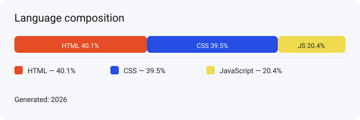

# CV Website

A clean, minimal personal CV / portfolio website built with HTML, CSS and JavaScript.

✨ Aesthetic, responsive, and easy to customize — ideal as a personal landing page or resume site.

---

## Features

- Simple, responsive layout
- Clean typography and color system
- Ready-to-edit sections for profile, experience, skills, projects, and contact
- No build step — just open `index.html`

---

## Tech Stack

- HTML (40.1%)
- CSS (39.5%)
- JavaScript (20.4%)

---

## Live Preview

Open `index.html` in your browser or host the folder with any static-hosting service (GitHub Pages, Netlify, Vercel).

---

## Suggested repository organization

This repository is small and static; here’s a tidy layout you can follow to keep things organized:

- index.html — main entry
- assets/
  - css/ — stylesheets (e.g. `styles.css`)
  - js/ — scripts (e.g. `main.js`)
  - img/ — images and icons
  - lang-graph.svg — language composition graphic (this file)
- README.md — project overview (this file)
- LICENSE — license file

If you want to move files into these folders I can create a commit that moves them into the structure — tell me if you want that.

---

## How to edit

1. Update `index.html` to change sections and content.
2. Modify `assets/css/styles.css` for look & feel.
3. Use `assets/js/main.js` to add interactive behaviors.

---

## Contributing

Feel free to open issues or PRs to refine styling, add accessibility improvements, or add example content.

---

## License

This project is provided under the MIT License — see `LICENSE` for details.

---

Made with ❤️ by @shashank17mishra
